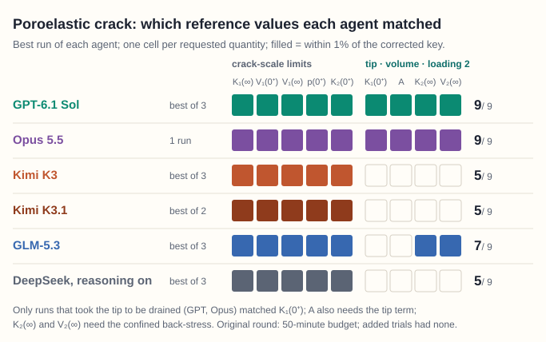

# MechanicsHarness

**How AI agents and mechanics can work together, with every result checked against an independent reference or a
measurement.**

Website: **https://mechanicsharness.org**

## Featured case: drained at the tip, undrained at the crack

A crack in a fluid-saturated solid is loaded suddenly. At the crack scale the solid has no time to drain, but within √(ct) of
each tip it drains at once. The task asked for the tip intensity just after loading without saying which limit comes first;
the key takes the tip limit first, which gives the drained value, 0.808 times the crack-scale value, and gives partial credit
for the crack-scale value itself. Problem from E. Detournay and A. H.-D. Cheng
(1991), [*Int. J. Solids Struct.* 27, 1645–1662](https://doi.org/10.1016/0020-7683(91)90067-P), given to the agents without
the paper.

Of fifteen runs by six agents, thirteen matched all five crack-scale values. Only GPT, in three of three runs, and Opus 5.5, in
one, found the drained-tip value; the other eleven gave the crack-scale value, which the key credits in part.

Each row is an agent's best saved run, October 2026 (of three runs for GPT, Kimi K3, GLM-5.3 and DeepSeek, two for Kimi K3.1,
one for Opus 5.5); a filled cell is a value within 1% of the corrected key (0.01 absolute for K₂(0⁺),
whose key value is 0). Key and checker as corrected on 26 October 2026; the [case page](https://mechanicsharness.org/case-studies/poroelastic-crack.html)
has the task, the key and every run's saved answer, and [`case-studies/poroelastic-crack/`](case-studies/poroelastic-crack/) holds
its files. Also left out: three DeepSeek runs with reasoning off, which matched two or three of the
nine values and missed the drained-tip value.

## Three levels

| Level | What the agent does | Cases |
|---|---|---|
| 1. Classical problems | Analysis problems with known answers, from published papers. The agent derives and computes the asked quantities. | Poroelastic crack (Detournay and Cheng 1991); thin-film cracking (Xia and Hutchinson 2000) |
| 2. Published research models | The agent implements a recent paper's model as working simulation code, checked against an independent reference. | Rock fracture (Anand 2026); battery fatigue (Noii et al. 2024) |
| 3. Real-world problems | Open questions without a published answer, judged against measurements. This is the aim. | Planned |

Results are dated. As AI agents improve, newer agents are run on the same cases, so the record shows how far up the levels
they reach. Errors are reported as well as successes.

## How every result is checked

Each case restates a published problem as a self-contained task. The agent's answer, or the code it writes, is compared with
an independent reference that the agent never sees. A person asks what each mismatch means before calling it a failure, and
separates the agent's errors from errors in our own checks. More on the site:
[what it evaluates](https://mechanicsharness.org/evaluates.html),
[how a benchmark is built](https://mechanicsharness.org/building.html) and
[the evaluation policy](https://mechanicsharness.org/evaluation.html).

## Get started and contribute

The battery benchmark is released in the code repository,
[agent-mechanics-benchmarks-public](https://github.com/tengzhang48/agent-mechanics-benchmarks-public): the task, host, scorer, reference code, the three runs and their results,
with a practice problem that anyone can rerun. The rock benchmark is in preparation. Two fracture mechanics cases, the
[poroelastic crack](https://mechanicsharness.org/case-studies/poroelastic-crack.html) and
[thin-film cracking](https://mechanicsharness.org/case-studies/xia-hutchinson-film.html), are released on this website, each
with its task, key, checker and the agents' runs (folders under `case-studies/`).

You can already ask for your own element to be scored on the battery benchmark's hidden problem (see the code repository's
`CONTRIBUTING.md`). We plan to accept proposed cases once the evaluation workflow has been exercised on a contributed
submission. For the benchmarks, please [open an issue in the code repository](https://github.com/tengzhang48/agent-mechanics-benchmarks-public/issues); for this website,
[open an issue in this repository](https://github.com/tengzhang48/mechanicsharness.org/issues).

## This repository

The website itself: plain HTML and CSS, no build step, served by GitHub Pages.

| Path | Content |
|---|---|
| `index.html` | Home page |
| `evaluates.html`, `building.html`, `evaluation.html`, `get-started.html` | The other pages |
| `404.html` | Page not found |
| `case-studies/battery-fatigue.html` | The battery benchmark's case study |
| `case-studies/poroelastic-crack.html`, `case-studies/poroelastic-crack/` | The featured case: its page, and its files (task, key, checker, every run, records) |
| `case-studies/xia-hutchinson-film.html`, `case-studies/xia-hutchinson-film/` | The thin-film cracking case: its page and its files |
| `assets/` | Style sheet, site icon and figures |
| `CNAME`, `.nojekyll` | GitHub Pages settings |
| `LICENSE`, `LICENSE-CONTENT` | Licences (below) |

To preview locally, run `python3 -m http.server 8000` in this folder and open http://127.0.0.1:8000/.

## Credits

MechanicsHarness is maintained by Teng Zhang, Syracuse University. The site design follows the Shape Morphing Data Commons
([morphingdatacommons.org](https://morphingdatacommons.org)) of Lining Yao's Morphing Matter Lab, UC Berkeley. The site icon
shows the von Mises stress contours at a mode-I crack tip (plane strain, ν = 0.3).

## Licence

The text and figures are licensed under [CC BY 4.0](https://creativecommons.org/licenses/by/4.0/) (`LICENSE-CONTENT`); the
HTML, CSS and other code under the MIT License (`LICENSE`).
